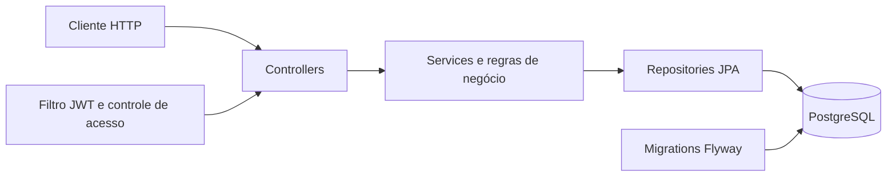

# NERVA Build — Backend multi-loja

Backend de um MVP para catálogo, clientes, pedidos e estoque de lojas de materiais de construção. O projeto explora isolamento por loja, autenticação JWT, regras transacionais de pedido e consistência de estoque.

> Projeto histórico pausado e preparado para portfólio. Não é um serviço em produção.

## O que este projeto demonstra

- arquitetura em camadas com controllers, services, repositories e DTOs;
- API REST com validação de entrada e tratamento padronizado de erros;
- autenticação JWT para usuários internos e compradores;
- autorização baseada em papéis e loja do usuário autenticado;
- multi-tenancy por `store_id`, reforçado no código e no banco;
- migrations versionadas com Flyway;
- criação de pedido com preço calculado no backend e snapshots históricos;
- transições de status com baixa e restauração de estoque;
- lock pessimista para proteger a confirmação concorrente de pedidos;
- testes de integração com MockMvc, PostgreSQL e Testcontainers.

## Tecnologias

- Java 21
- Spring Boot 4
- Spring Web MVC
- Spring Data JPA / Hibernate
- Spring Security
- JWT com JJWT
- PostgreSQL 16
- Flyway
- Maven
- JUnit, MockMvc e Testcontainers
- Docker

## Arquitetura



O painel administrativo nunca recebe livremente a loja que deseja operar. O `storeId` é derivado do usuário autenticado. Nos fluxos públicos, a loja é informada explicitamente por `storeId`, pelo header `X-Public-Store` ou pelo subdomínio.

## Funcionalidades implementadas

### Catálogo

- cadastro, edição e desativação de produtos e categorias;
- SKU e slug únicos por loja;
- catálogo público apenas com registros ativos;
- filtros por texto e categoria;
- marketplace restrito às lojas marcadas como visíveis;
- unidade de venda, marca, peso, dimensões e quantidade mínima.

### Pedidos e estoque

- criação de pedido por comprador autenticado;
- validação de identidade, loja, itens, quantidade mínima e estoque;
- cálculo de preço e total no backend;
- snapshots de comprador, endereço, produto, SKU, unidade e preço;
- fluxo `PENDING → CONFIRMED → SEPARATING → SHIPPED → DELIVERED`;
- cancelamento nos estados permitidos;
- baixa de estoque ao confirmar e restauração ao cancelar;
- lock pessimista durante alterações de estoque;
- histórico e detalhe de pedidos do comprador.

### Segurança e multi-loja

- tokens distintos para usuário interno e comprador;
- papéis `STORE_OWNER`, `STORE_ADMIN` e `STORE_OPERATOR`;
- consultas administrativas sempre limitadas à loja autenticada;
- onboarding público desabilitado por padrão;
- segredo JWT obrigatório;
- CORS configurável por ambiente.

## Como executar localmente

### Requisitos

- Java 21
- Docker com Docker Compose

### 1. Suba o PostgreSQL

```bash
docker compose up -d
```

### 2. Configure o ambiente

No Linux/macOS:

```bash
cp .env.example .env
set -a
source .env
set +a
```

Substitua o valor de `APP_JWT_SECRET` em `.env` por um segredo forte com pelo menos 64 caracteres. O Spring não carrega arquivos `.env` sozinho; os comandos acima exportam as variáveis para o processo atual.

### 3. Inicie a API

```bash
./mvnw spring-boot:run
```

O Flyway cria e atualiza o schema automaticamente. A API fica disponível em `http://localhost:8080`.

### Usuário demonstrativo

As migrations criam um proprietário da loja de demonstração:

```text
Loja: 1
Email: owner+1@nervabuild.local
Senha: 123456
```

A senha é destinada somente ao ambiente demonstrativo e termina armazenada como BCrypt após a migration `V12`.

Exemplo de login:

```bash
curl -X POST http://localhost:8080/api/auth/login \
  -H 'Content-Type: application/json' \
  -d '{"email":"owner+1@nervabuild.local","password":"123456","storeId":1}'
```

## Testes

Com o Docker ativo, execute:

```bash
./mvnw test
```

Não é necessário subir o `docker-compose.yml` para os testes. O Testcontainers cria um PostgreSQL 16 descartável, o Flyway aplica todas as migrations e o container é removido ao final.

A suíte cobre atualmente:

- inicialização completa do contexto e validação das migrations;
- CRUD e isolamento multiloja de produtos e categorias;
- permissões administrativas;
- confirmação e cancelamento com baixa/restauração de estoque;
- rejeição por estoque insuficiente;
- histórico de pedidos restrito ao comprador autenticado;
- identidade do comprador, quantidade mínima e snapshots do pedido.

Resultado verificado durante a preparação desta versão:

```text
Tests run: 37, Failures: 0, Errors: 0, Skipped: 0
BUILD SUCCESS
```

## Configurações principais

| Variável | Obrigatória | Finalidade |
|---|---:|---|
| `APP_JWT_SECRET` | Sim | Assinatura dos tokens JWT |
| `SPRING_DATASOURCE_URL` | Não em desenvolvimento | URL JDBC do PostgreSQL |
| `SPRING_DATASOURCE_USERNAME` | Não em desenvolvimento | Usuário do banco |
| `SPRING_DATASOURCE_PASSWORD` | Não em desenvolvimento | Senha do banco |
| `APP_ONBOARDING_PUBLIC_ENABLED` | Não | Libera cadastro público de lojas |
| `APP_CORS_ALLOWED_ORIGINS` | Não | Origens CORS separadas por vírgula |

## Limitações conhecidas

- não há pagamento, frete ou webhook de gateway;
- listagens ainda não possuem paginação;
- não há recuperação de senha nem verificação de email;
- não há histórico formal de movimentações de estoque;
- observabilidade está limitada a logs da aplicação;
- a visão futura de IA e medição por câmera não foi implementada neste backend.

## Contexto de portfólio

O projeto foi desenvolvido em equipe. Minha contribuição concentrou-se principalmente no backend, no entendimento do domínio e na implementação das regras de negócio. Consulte [PORTFOLIO.md](PORTFOLIO.md) para detalhes sobre participação, decisões e retrospectiva.

A [documentação técnica original](readme.md) e os documentos em [`docs/`](docs/) preservam o raciocínio arquitetural produzido durante o MVP.

## Status

MVP pausado e mantido como estudo de arquitetura backend. O repositório foi revisado para ser executável e verificável, mas não representa um produto pronto para operação comercial.
